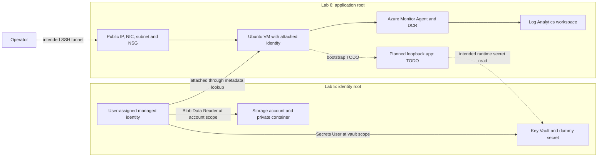

# Azure managed identity and VM hosting: a design case study

This case study traces the identity, access, and operational boundaries in Labs 5 and 6. It demonstrates how the Terraform configuration is structured and what must be checked before the application-hosting exercise can be called complete.

**Status:** the infrastructure configuration is present and both roots passed static Terraform validation during the portfolio review on 11 October 2026. Application bootstrap and runtime behavior remain TODOs. There are no committed `evidence.md` files for these labs confirming successful deployment, secret retrieval, log ingestion, or cleanup. This is a configuration review of an ongoing lab, not a production deployment report.

## Problem and scope

The exercise calls for a small Linux-hosted service that accesses a dummy Key Vault secret through a managed identity. Operators should reach the service through an SSH tunnel, while guest events flow to Log Analytics. Separate Terraform roots should own the shared identity resources and the application infrastructure.

The code uses Terraform, AzureRM, an Ubuntu VM, Microsoft Entra managed identity, Azure RBAC, Key Vault, and Azure Monitor. Python, cloud-init, systemd, and rsyslog are the intended guest implementation; they are not a completed application stack yet.

## Architecture and ownership



Solid edges describe configured relationships; dashed edges describe intended behavior that still needs implementation or verification. The diagram does not establish that the current NSG permits the intended SSH path.

[Lab 5 configuration](../05-identity-rbac-keyvault/main.tf) owns the identity, vault, dummy secret, storage, role assignments, and optional vault diagnostics. [Lab 6 configuration](../06-application-hosting/main.tf) reads the identity and vault through data sources and owns its own resource group, network, VM, and guest-monitoring resources. Lab 6 does not import Lab 5's resources into another state.

## Decisions and tradeoffs

| Decision in the code | Reason and operational consequence |
| --- | --- |
| User-assigned identity owned by Lab 5 | The identity can retain its lifecycle independently of the Lab 6 VM. VM attachment uses its resource ID; role assignments use its principal ID. The planned app selects it with its client ID. |
| Separate operator and workload RBAC | The Terraform runner receives Key Vault Secrets Officer on the vault to create the dummy secret. The workload receives Key Vault Secrets User on that vault, rather than that write-capable role. These are distinct permission paths. |
| Storage read permission at account scope | The implementation grants Storage Blob Data Reader on the storage account. The notes mention container scope, but the resource uses account scope; a narrower scope needs a separate decision. |
| Metadata-only lookups in Lab 6 | Lab 6 passes the identity client ID, vault URI, and secret name to its template. It does not read the secret value through a Terraform data source. Lab 5 still manages a dummy secret value, which can remain in state and saved plans. |
| Public IP with planned loopback application | The lab avoids a load balancer and NAT Gateway. Its intended operator path is SSH and local port forwarding, rather than public HTTP. The access rule and guest implementation must be corrected or completed before that behavior is established. |
| Guest-log collection through AMA and a DCR | The code configures a user-facility syslog stream to a 30-day Log Analytics workspace. The guest still needs to emit events; extension installation alone is not ingestion evidence. |

Each root currently uses local state: neither root declares a remote backend. Use dummy secret data and protect local state and plans. A shared environment would need a deliberate state-storage and access-control design before use.

## A recorded failure: regional VM SKU availability

[Lab 6's notes](../06-application-hosting/notes.md) record a VM creation failure with `SkuNotAvailable` for `Standard_B1s` in `eastus`. The 7 October 2026 entry says a subscription SKU lookup also showed restrictions for `Standard_B1ms` and `Standard_B2s`; `Standard_D2as_v4` showed no listed restriction and supported the image's x64 architecture.

The recorded response was to select `Standard_D2as_v4` in ignored local inputs while retaining the existing region. The committed variable default remains `Standard_B1s`. This documents a troubleshooting decision, not a confirmed successful retry: the notes explicitly leave deployment capacity unconfirmed.

The lesson is to distinguish configuration validity, subscription restrictions, quota, and actual deployment capacity. A larger fallback can increase cost and should be reviewed and kept short-lived. The historic SKU lookup is not a promise of current availability.

## What the review found

| Area | Verified from the repository | Remaining work |
| --- | --- | --- |
| Infrastructure syntax | Labs 5 and 6 initialized with backend access disabled and passed `terraform validate` using Terraform 1.13.5 during the portfolio review. | A reviewed plan and runtime resource checks are still needed; static validation cannot establish application health. |
| SSH access | The NSG resource is associated with the app subnet. | Its `allowSSH` rule currently uses source port `22`, destination port `*`, source address `*`, and the administrator CIDR as destination. That differs from the intended administrator-source rule to destination TCP/22. Correct and inspect effective rules before deployment. |
| Guest bootstrap | The VM renders `cloud-init.yaml.tftpl` with non-secret metadata. | The template contains TODOs, and `app/app.py` exits with an implementation reminder. Package installation, service setup, endpoints, and runtime secret access are incomplete. |
| Operator handoff | Outputs include VM, identity, vault, and workspace metadata. | The SSH command uses a directory for its identity-file argument, and the tunnel command quotes a tilde path. Replace these with a valid private-key file path before use. |
| Monitoring | AMA, syslog DCR, destination, and VM association are configured. | Confirm guest logging, agent health, and receipt of a sanitized marker in Log Analytics. |

These findings are documented here without changing the lab solution or removing its study checkpoints.

## Reproduce the static review

From a local clone, install a Terraform version satisfying each root's `versions.tf`. The committed lock files identify provider selections. Provider installation needs network access; these commands do not plan or apply cloud resources.

```bash
for lab in 05-identity-rbac-keyvault 06-application-hosting; do
  (
    cd "$lab" || exit 1
    terraform init -backend=false -lockfile=readonly && terraform validate
  ) || exit 1
done
```

Review formatting separately with `terraform fmt -check`. Keep `.terraform/`, local `.tfvars`, state, and plans out of Git; retain provider lock files. Follow each lab README for inputs and the full exercise rather than treating this case study as an apply script.

## Evidence needed for a completed case study

After completing and reviewing the lab code, record a concise, sanitized `evidence.md` covering:

- The reviewed plan and resource ownership boundaries; no unintended Lab 5 changes from Lab 6.
- Cloud-init completion and an active, unprivileged application service.
- Successful tunnel access and blocked direct public application access.
- A runtime dummy-secret read using the VM identity, without recording tokens or secret values.
- A guest syslog marker received in Log Analytics, with identifiers redacted.
- One diagnosed access or identity failure and the verified recovery.
- Cleanup results, including retained resources and any soft-deleted vault.

No deployment, performance, availability, or cost-savings result is claimed here. Private connectivity, tighter access controls, production secret management, and operational monitoring remain future design work.

## Cost and cleanup

VM compute, disks, public IPs, storage, and log ingestion can incur charges. The recorded larger VM fallback deserves particular cost review. Stopping a VM is not a complete cleanup of its associated resources.

Inspect `terraform plan -destroy` in Lab 6's root before deciding to run `terraform destroy`. Remove Lab 6 before Lab 5 so the shared identity and vault remain available while the VM exists. Review Lab 5's destroy plan separately, and verify remaining resources and Key Vault soft-delete behavior. No destroy operation was performed for this case study.

[Lab 5 exercise](../05-identity-rbac-keyvault/README.md) · [Lab 6 exercise](../06-application-hosting/README.md) · [Repository overview](../README.md)
